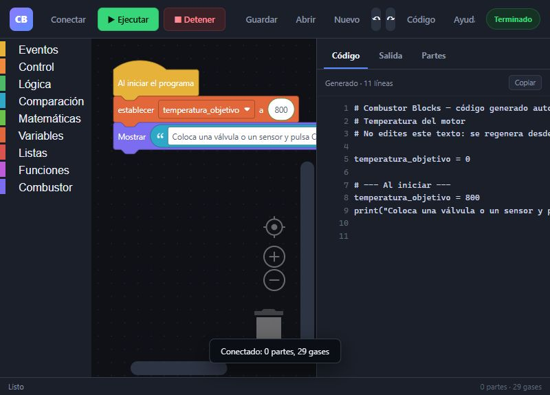

# Combustor Blocks

**Programación visual estilo Scratch para Combustor.**  
Los bloques se traducen al lenguaje real del juego (GS), se validan con su
compilador y se ejecutan con su propia máquina virtual.



---

## Qué es

Combustor Blocks es un mod para **Combustor** (Steam build 26701522, Unity
6000.3.2f1, IL2CPP) que añade un editor de bloques conectables. No inventa un
lenguaje nuevo ni un intérprete paralelo:

```
bloques (Blockly) → generador JS → código GS → GsCompiler.Compile
                                                ↓
                                    ScriptRig.Start(sim) → GsVm
```

El programa resultante es un script GS normal: aparece en el editor de código
del juego, se guarda con el motor y viaja con los códigos de compartir.

## Puertas lógicas (0.2.0)

El botón **Puertas lógicas** de la barra inferior abre un panel con todas las
puertas: **AND, OR, NOT, XOR, NAND, NOR y XNOR**. También están en la categoría
**Puertas lógicas** de la paleta.

Las entradas no son botones: son condiciones reales del motor, por ejemplo
`sensor_1.temperature > 800`, `valve_1.is_open` o `gate_1.flow > 10`. Las
salidas pueden ser `valve_1.open()`, `injector_1.rate = 40`, etc. Las puertas
se compilan a expresiones GS normales, así que no añaden un runtime nuevo.

El editor se sirve como una aplicación web local desde el propio mod
(`http://127.0.0.1:8765/`). Es una decisión deliberada: en esta build de Unity 6
IL2CPP, los hooks IMGUI de MelonLoader (`OnGUI`) no se ejecutan y los parches
sobre `GasSimHud.OnGUI` / los MonoBehaviours inyectados resultaron inestables.
La interfaz web es el camino estable y permite usar **Blockly**, que no es viable
de forma nativa dentro de Unity IL2CPP.

---

## Requisitos

- **Combustor** en Steam (probado en la build 26701522, Unity 6000.3.2f1).
- **MelonLoader 0.7.3** instalado en el juego.
  - https://github.com/LavaGang/MelonLoader/releases/tag/v0.7.3
- Windows x64.
- Un navegador moderno (Chrome, Edge, Firefox).

---

## Instalación

1. Instala **MelonLoader 0.7.3** en Combustor (el instalador detecta el juego).
2. Cierra Combustor.
3. Extrae este ZIP en la carpeta que contiene `EngineSimulator.exe`, fusionando
   las carpetas `Mods` y `UserData`.
4. La estructura debe quedar así:

```
EngineSimulator.exe
Mods/
  CombustorBlocks.dll
UserData/
  CombustorBlocks/
    web/
      index.html
      app.js
      style.css
      blockly/...
    Abrir editor.url
    Abrir editor.bat
```

5. Arranca Combustor y entra en **Sandbox**.
6. Abre el editor:
   - doble clic en `UserData\CombustorBlocks\Abrir editor.url`, o
   - abre `http://127.0.0.1:8765/` en el navegador, o
   - pulsa **F7** dentro del juego.

En el editor, pulsa **Conectar** para leer las partes del motor abierto.

> El mod mantiene el juego ejecutándose en segundo plano
> (`Application.runInBackground`) para que puedas programar en el navegador
> mientras la simulación sigue viva.

---

## Uso rápido

1. Entra en **Sandbox** y coloca una válvula, un inyector o un sensor.
2. En el editor, pulsa **Conectar** (o **Actualizar** en la pestaña Partes).
3. Arrastra **Al iniciar el programa** y **En cada actualización** al lienzo.
4. Arrastra bloques morados de **Combustor** dentro de los eventos.
5. Pulsa **Ejecutar**.

El panel **Código** muestra el GS generado y resalta la línea del error si el
compilador del juego lo rechaza.

### Ejemplo equivalente al enunciado

```
Al iniciar el programa:
    crear variable temperatura_objetivo = 800

En cada actualización:
    si sensor_1.temperature > temperatura_objetivo:
        mostrar "Temperatura demasiado alta"
    si no:
        mostrar "Temperatura dentro del límite"
```

En los bloques:

- `Al iniciar` → `Crear variable temperatura_objetivo = 800`.
- `En cada actualización` → `Si [sensor_1.temperature] > [temperatura_objetivo]`
  → `Mostrar "Temperatura demasiado alta"` / `Si no` → `Mostrar "Temperatura
  dentro del límite"`.

El sensor debe existir: se coloca con **Place sensor** en el editor de código
del juego (botón **Code [beta]** del Sandbox). Después pulsa **Conectar** para
que aparezca en el desplegable.

---

## Bloques

### Eventos

| Bloque | Comportamiento |
|---|---|
| Al iniciar el programa | Código de nivel superior; una vez al pulsar Ejecutar. |
| En cada actualización | Cuerpo de `while True:`; una pasada por tick (1/64 s). |
| Al recibir evento | Flag comprobado una vez por tick, tras la actualización. |
| Enviar evento | Marca el flag del evento. |
| Al detener el programa | Se ejecuta desde **Detener programa** (`__cb_stop()`). |
| Al comenzar la simulación | Equivale a **Al iniciar** (el script solo corre con la simulación). |
| Al finalizar la simulación | No existe en GS; no se ofrece. |

### Control

`Si`, `Si no`, `Si no, si`, `Repetir N veces`, `Repetir para siempre`,
`Mientras`, `Hasta que`, `Esperar`, `Detener programa`, `Detener este bloque`
(`break`), `continuar`.

### Lógica, comparaciones y matemáticas

`y`, `o`, `no`, `verdadero`, `falso`, `=`, `≠`, `>`, `<`, `≥`, `≤`, suma, resta,
multiplicación, división, módulo, potencia, raíz, absoluto, redondeo,
aleatorio entre dos valores, `pi`.

> GS no tiene `random()` ni `pow()`. El generador añade dos funciones de apoyo
> (`__cb_rand`/`__cb_random` y `__cb_pow`) escritas en GS, no un runtime aparte.

### Variables, listas y funciones

Variables con valor inicial, cambiar, leer, eliminar; listas con crear, añadir,
eliminar, longitud, contiene, posición; funciones con parámetros, llamada y
`return` (bloques de procedimientos de Blockly).

### Datos reales de Combustor

Los desplegables se rellenan con las partes reales del motor conectado. Cada
parte solo ofrece los miembros que el juego expone:

| Parte | Miembros |
|---|---|
| Válvula | `open()`, `close()`, `toggle()`, `is_open`, `is_broken`, `pressure`, `temperature` |
| Inyector | `rate`, `temperature`, `max_pressure`, `gas`, `on/off/toggle/is_on/is_broken` |
| Encendedor | `temperature`, `on/off/...` |
| Agujero negro | `pull` |
| Ventilador | `power`, `top_speed`, `reverse` |
| Filtro | `min_size`, `max_size`, `flow_rate` |
| Compuerta | `reverse`, `limit`, `flow` (solo lectura) |
| Pistón | `position`, `speed` (solo lectura) |
| Sensor | `temperature`, `pressure`, `density`, `speed`, `speed_x`, `speed_y`, `gas("X")`, `moles("X")` |
| Nave (Labrek) | `altitude`, `speed`, `propellant`, `thrust`, `mass`, `launched` |
| Tienda (Feed the Hole) | `cash`, `stock("X")`, `price("X")`, `buy("X", moles)` |

Los rangos reales (por ejemplo, `rate` 0.1–1000, `temperature` 50–6000 K) se
muestran en la documentación de cada miembro y se validan al ejecutar.

---

## Interfaz

- **Paleta** con categorías de colores y bloques arrastrables.
- **Lienzo infinito** con zoom, desplazamiento, papelera, deshacer/rehacer,
  copiar/pegar/duplicar (Blockly).
- **Anidado** de bloques en condiciones, bucles y funciones.
- **Panel de código** con numeración de líneas y resaltado del error.
- **Salida** con `print()` y errores del juego.
- **Partes** con los nombres, tipos y miembros reales del motor.
- **Guardar / Abrir / Nuevo**; autosave en el navegador y `project.json` en disco.
- **Conectar** para releer las partes tras colocarlas en el juego.
- **Pausa / Reanudar**: si Combustor se pausa al perder el foco, el chip muestra
  «En pausa», la barra inferior ofrece **Reanudar simulación** y **Ejecutar**
  también reanuda antes de arrancar.

---


### Idioma

El selector **Auto / ES / EN** de la barra superior cambia toda la interfaz:
editor, bloques, tooltips, ayuda, asistente IA y mensajes de error.

- **Auto** usa el idioma del navegador. Si el navegador no está en español o
  inglés, usa el idioma del juego (`L.Language`, vía `/api/lang`).
- **ES / EN** fuerzan el idioma.
- La elección se guarda en `localStorage` y el proyecto se conserva al recargar.
- Blockly carga sus mensajes en español (`blockly/es.js`) o inglés (incluido).

## Asistente IA

La pestaña **IA** del editor ayuda a crear programas sin escribir código.

### Modo integrado (sin conexión)

Funciona siempre, sin API keys ni modelos:

- **Temperatura**: genera un control que lee un sensor y compara con un objetivo.
- **Válvula**: abre/cierra una válvula según la presión.
- **Contador**: contador que aumenta una vez por segundo.
- **Aleatorio**: número seudoaleatorio con aritmética de GS (no existe `random()`).
- **Explicar error**: traduce el error del compilador/runtime a una explicación y una solución.

Los programas generados se insertan como un bloque **Código GS (avanzado)**,
se validan con el compilador real del juego y se pueden ejecutar directamente.
Al insertar se reemplaza el programa actual; **Ctrl+Z** deshace.

### Modelo externo opcional

En **IA → Ajustes** puedes conectar un modelo local o remoto:

| Proveedor | URL base | Modelo de ejemplo |
|---|---|---|
| Ollama | `http://127.0.0.1:11434` | `llama3.1` |
| OpenAI-compatible | `https://api.openai.com` | `gpt-4o-mini` |
| LM Studio | `http://127.0.0.1:1234` | el modelo cargado |

- La petición sale por el **servidor local del mod** (`/api/ai`), así que no hay
  problemas de CORS.
- La API key (si usas un proveedor que la necesita) se guarda en el
  `localStorage` del navegador y solo se envía al mod local y al proveedor.
- El prompt incluye el lenguaje GS, las partes reales del motor y el programa
  actual como contexto.
- Si el modelo no está disponible, el editor cae automáticamente al asistente
  integrado y lo indica en el chat.

### Privacidad

- El modo **Integrado** no envía nada a Internet.
- El modo externo envía tu petición, las partes del motor y el programa actual
  al proveedor que configures. No uses claves sensibles en máquinas compartidas.

### Límites

- El modelo puede inventar partes o miembros; el panel **Código** y la validación
  del juego lo detectan.
- El código generado se inserta como GS literal; puedes editarlo después con
  bloques o con el propio bloque de código.
- La IA no ejecuta nada por sí sola: tú revisas y pulsas **Ejecutar**.

## Arquitectura

```
Combustor (Unity IL2CPP)
│
├─ Mods/CombustorBlocks.dll (MelonLoader 0.7.3)
│   ├─ WebServer         TcpListener en 127.0.0.1:8765
│   ├─ ApiBridge         cola de acciones al hilo principal
│   ├─ ApiState          snapshot JSON de partes/gases/estado
│   ├─ GameApi           ScriptWindow, GasSimulation, ScriptRig
│   └─ ScriptRunner      GsCompiler.Compile + ScriptRig.Start
│
└─ Navegador
    └─ UserData/CombustorBlocks/web
        ├─ index.html / style.css
        ├─ app.js        bloques, generador GS, llamadas a la API
        └─ blockly/      Blockly 13.4.0 + español
```

### API local

| Método | Ruta | Descripción |
|---|---|---|
| GET | `/api/health` | Estado del servidor. |
| GET | `/api/lang` | Idioma actual del juego (para el modo Auto). |
| POST | `/api/connect` | Lee el motor y devuelve partes/gases. |
| GET | `/api/state` | Último snapshot. |
| POST | `/api/validate` | `{code}` → `{ok,error,line}` con el compilador del juego. |
| POST | `/api/run` | `{code}` → compila, valida y ejecuta con `ScriptRig`. |
| POST | `/api/stop` | Detiene el script. |
| GET | `/api/status` | `running`, `status`, `error`, `errorLine`, `log`. |
| GET/POST | `/api/project` | Proyecto Blockly guardado (`project.json`). |

El servidor escucha solo en `127.0.0.1`, rechaza peticiones de API con un
`Origin` externo y no usa CORS. No hay autenticación: cualquier proceso local
puede controlarlo; no lo expongas a la red.

---

## Verificación realizada

Probado en la build 26701522 con MelonLoader 0.7.3:

- MelonLoader carga el mod y genera los interop assemblies.
- El servidor responde `health`, `connect`, `run`, `status`, `stop`.
- `/api/connect` devuelve **29 gases** en Sandbox.
- Un programa GS generado desde el editor (variables, listas, `for`,
  `while`, `if`, funciones, `print`) compila con `GsCompiler.Compile`.
- Se ejecuta con `ScriptRig` y produce la salida esperada:
  `hola desde JS` ×3.
- Un programa con eventos, `__cb_pow(2,3)=8`, `__cb_random(1,5)`, `recibido`,
  `adios` y `stop()` termina sin errores.
- El error de una parte inexistente se muestra como
  `Error línea 13: Nothing is called 'sensor_1'.` y resalta la línea.
- Guardar escribe `UserData/CombustorBlocks/project.json`; Abrir lo recupera.
- El árbol de Blockly, las categorías, el zoom y el panel de código funcionan
  sin errores de consola.
- Simulación en segundo plano: el script sigue avanzando (`paused=false`, el log
  crece); si el juego se pausa, `/api/resume` lo desbloquea.

---

## Limitaciones conocidas

1. **Al detener** solo se ejecuta desde el bloque **Detener programa**; el botón
   Stop del juego llama a `ScriptRig.Stop()` y no ofrece un callback.
2. **Al finalizar la simulación** no existe en GS; se omite.
3. **Eventos cooperativos**: `Al recibir` se evalúa una vez por tick.
4. **`random()` y `pow()`** no existen en GS; se generan helpers en GS.
5. **Los sensores deben existir**: se colocan con **Place sensor** en el editor
   del juego; no hay lecturas globales inventadas.
6. **Una script por motor**; los sombreros se ejecutan en secuencia.
7. **El script corre con la simulación**; en pausa no avanza. El editor muestra
   «En pausa» y permite reanudar con un botón o al pulsar Ejecutar.
8. **IL2CPP**: la capa `GameApi` concentra el acceso a campos internos; una
   actualización del juego puede requerir ajustes.
9. **Interfaz web**: el juego y el navegador deben estar en la misma máquina;
   el puerto puede cambiar si 8765 está ocupado (mira el log).
10. **Blockly** es una dependencia web (Apache 2.0, incluida en `web/blockly`).

---

## Criterios de aceptación

| Criterio | Estado |
|---|---|
| Crear programas completos con bloques | Sí |
| IF/ELSE | Sí (`controls_if` + `elseif`/`else`) |
| AND/OR/NOT | Sí |
| Bucles y repeticiones | Sí (`repeat`, `forever`, `while`, `until`, `for`) |
| Variables | Sí (crear, fijar, cambiar, leer, borrar) |
| Comparaciones | Sí (6 operadores) |
| Anidar bloques | Sí |
| Generar código válido | Sí, validado con `GsCompiler.Compile` |
| Ejecutar en Combustor | Sí, `ScriptRig.Start` (logs verificados) |
| Guardar/recuperar | Sí, `project.json` + localStorage |

---

## Créditos

- **Combustor** y su lenguaje GS: Wendy / the game developers.
- **Mod de referencia** `CombustorPngMod` (theop): demostró MelonLoader 0.7.3,
  las rutas `Mods`/`UserData` y el uso de Harmony sobre métodos hoja.
- **Blockly** (Google): editor de bloques, Apache License 2.0.
- **MelonLoader** (LavaGang): cargador de mods.

## Licencia

El código del mod se distribuye bajo licencia MIT (ver `LICENSE.txt`).
Blockly se distribuye bajo Apache 2.0 (ver `UserData/CombustorBlocks/web/blockly/LICENSE`).
